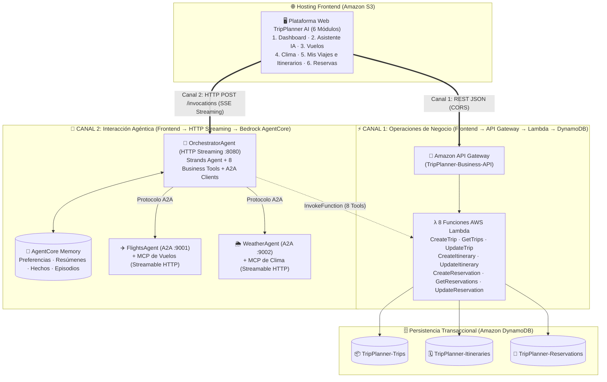

# TripPlanner AI · Your AI Travel Companion 🧭✈️🌦️

**Trabajo Final · Programación Agéntica — Del Playground a una plataforma inteligente para planificar y gestionar viajes**

Plataforma web distribuida sobre **AWS** que integra un sistema **multiagente real** en **Amazon Bedrock AgentCore** (**Strands Agents**, protocolo **A2A**, servidores **MCP** de vuelos y clima, y **AgentCore Memory**) con un backend **Serverless** (**Amazon API Gateway**, **8 funciones AWS Lambda** y **3 tablas en Amazon DynamoDB**) y un **Frontend de 6 módulos** publicado en **Amazon S3**.

---

## 🏛️ Arquitectura General (Dos Canales Independientes)



---

## 🧩 Los 3 Agentes en Amazon Bedrock AgentCore (Requisito No Negociable)

| Agente | Protocolo | Puerto Local | Especialidad y Conexiones |
| :--- | :---: | :---: | :--- |
| **`OrchestratorAgent`** | `HTTP Streaming` | `8080` | Interactúa con el usuario en streaming, gestiona `TripPlannerMemory`, delega vía **A2A** en `FlightsAgent` y `WeatherAgent`, y ejecuta las **8 Tools de negocio** respaldadas por AWS Lambda + DynamoDB. |
| **`FlightsAgent`** | `A2A` | `9001` | Especialista en cotización de vuelos conectado a servidor **MCP de Vuelos** (`search_airports`, `search_flights`) sobre Streamable HTTP. |
| **`WeatherAgent`** | `A2A` | `9002` | Especialista meteorológico conectado a servidor **MCP de Clima** (`get_forecast` / `mcp_get_weather`) sobre Streamable HTTP con pronóstico multipunto por días. |

---

## 🛠️ Las 8 Tools Obligatorias y Respaldo en AWS Lambda + DynamoDB

| Tool | Propósito | Función AWS Lambda | Ruta API Gateway (Canal 1) | Tabla DynamoDB |
| :--- | :--- | :--- | :--- | :--- |
| **`CreateTrip`** | Crear un viaje del usuario | `TripPlanner-CreateTrip` | `POST /trips` | `TripPlanner-Trips` |
| **`GetTrips`** | Consultar viajes del usuario | `TripPlanner-GetTrips` | `GET /trips`, `GET /trips/{tripId}` | `TripPlanner-Trips` (+ Itin/Res) |
| **`UpdateTrip`** | Actualizar datos de un viaje | `TripPlanner-UpdateTrip` | `PUT /trips/{tripId}` | `TripPlanner-Trips` |
| **`CreateItinerary`** | Crear el itinerario de un viaje | `TripPlanner-CreateItinerary` | `POST /itineraries` | `TripPlanner-Itineraries` |
| **`UpdateItinerary`** | Modificar un itinerario | `TripPlanner-UpdateItinerary` | `PUT /itineraries/{itineraryId}` | `TripPlanner-Itineraries` |
| **`CreateReservation`** | Registrar reserva asociada a un viaje | `TripPlanner-CreateReservation` | `POST /reservations` | `TripPlanner-Reservations` |
| **`GetReservations`** | Consultar reservas | `TripPlanner-GetReservations` | `GET /reservations` | `TripPlanner-Reservations` |
| **`UpdateReservation`** | Actualizar una reserva o su estado | `TripPlanner-UpdateReservation` | `PUT /reservations/{reservationId}` | `TripPlanner-Reservations` |

---

## 🖥️ Los 6 Módulos del Frontend (`frontend/index.html`)

1. **📊 Dashboard:** Resumen del viajero, KPIs de presupuesto en COP, próximos viajes, reservas recientes y botón directo para el **Escenario Obligatorio de Demostración**.
2. **💬 Asistente Conversacional:** Chat con el `OrchestratorAgent` mediante HTTP Streaming directo (Canal 2), chips de consulta rápida y botón de rotación de sesión para validar persistencia y memoria.
3. **✈️ Consulta de Vuelos:** Tarjetas comparativas (Wingo, Avianca, LATAM) con horarios, duración, precios en COP y creación de reserva simulada en 1 clic.
4. **🌦️ Información Meteorológica:** Temperatura (°C), condición, humedad (%), probabilidad de lluvia (%), índice UV, recomendaciones de equipaje y pronóstico para los 4 días.
5. **🗺️ Mis Viajes e Itinerarios:** Viajes guardados en DynamoDB, creación/edición de viajes y agenda interactiva día por día con costos por actividad.
6. **🎫 Gestión de Reservas:** Listado filtrable por estado (*Simulada*, *Pendiente*, *Confirmada*), creación, cambio de estado y asociación a un viaje.

---

## 📁 Estructura del Repositorio

```text
WorkshopAgentes/
├── template.yaml               # Plantilla IaC AWS SAM unificada (DynamoDB + 8 Lambdas + API GW + S3)
├── frontend/
│   └── index.html              # SPA de 6 módulos lista para Amazon S3
├── chat.html                   # Espejo directo de la aplicación Frontend
├── backend/
│   ├── src/
│   │   ├── handlers.py         # Handlers de las 8 funciones AWS Lambda + capa DynamoDB
│   │   └── __init__.py
│   ├── local_api_server.py     # Emulador local de Amazon API Gateway (Canal 1 en puerto 8085)
│   └── requirements.txt
├── app/
│   ├── OrchestratorAgent/      # Agente Orquestador (HTTP Streaming + A2A Client + 8 Tools Lambda)
│   │   ├── main.py
│   │   ├── business_tools.py   # Implementación de las 8 @tool conectadas a Lambda/DynamoDB
│   │   └── policies/a2a-invoke-policy.json
│   ├── FlightsAgent/           # Agente Especialista de Vuelos (A2A Server + MCP Vuelos)
│   │   └── main.py
│   └── WeatherAgent/           # Agente Especialista de Clima (A2A Server + MCP Clima)
│       └── main.py
├── agentcore/
│   ├── agentcore.json          # Definición declarativa de Runtimes y TripPlannerMemory
│   └── aws-targets.json        # Cuenta y región AWS
├── docs/
│   └── 10-arquitectura-dos-canales-y-entregable-final.md  # Documentación técnica completa
├── start_all_local.ps1         # Script para iniciar todos los servicios localmente
└── deploy_aws.ps1              # Script de despliegue en AWS (SAM + S3 + AgentCore)
```

---

## ☁️ Despliegue en AWS Cloud (100% Cloud — Sin Dependencias Locales)

La plataforma se encuentra totalmente desplegada y operando en **Amazon Web Services (AWS)** en la región `us-east-1`:

### URLs y Endpoints en Producción

| Componente | Servicio AWS | URL / Endpoint Activo |
| :--- | :--- | :--- |
| **Frontend Web (SPA)** | Amazon S3 Static Hosting | [http://tripplanner-ai-frontend-744617282997-us-east-1.s3-website-us-east-1.amazonaws.com](http://tripplanner-ai-frontend-744617282997-us-east-1.s3-website-us-east-1.amazonaws.com) |
| **Canal 1 (Operaciones de Negocio)** | Amazon API Gateway (REST + CORS + Throttling) | `https://5b6j1ip133.execute-api.us-east-1.amazonaws.com/prod` |
| **Canal 2 (Streaming Multiagente)** | Amazon Bedrock AgentCore Runtime | `https://bedrock-agentcore.us-east-1.amazonaws.com/runtimes/arn%3Aaws%3Abedrock-agentcore%3Aus-east-1%3A744617282997%3Aruntime%2Fworkshop2_OrchestratorAgent-tPLDXq487r/invocations` |
| **Agente Especialista Vuelos** | Bedrock AgentCore Runtime (A2A + MCP) | `arn:aws:bedrock-agentcore:us-east-1:744617282997:runtime/workshop2_FlightsAgent-fC6aTM9OHc` |
| **Agente Especialista Clima** | Bedrock AgentCore Runtime (A2A + MCP) | `arn:aws:bedrock-agentcore:us-east-1:744617282997:runtime/workshop2_WeatherAgent-s7pABA4FJm` |
| **Memoria Agéntica** | Amazon Bedrock AgentCore Memory | `arn:aws:bedrock-agentcore:us-east-1:744617282997:memory/workshop2_TripPlannerMemory-Z4G3f5GSF9` |
| **Persistencia DynamoDB** | Amazon DynamoDB (Pay-Per-Request) | `TripPlanner-Trips`, `TripPlanner-Itineraries`, `TripPlanner-Reservations`, `TripPlanner-Users` |

---

## 🛠️ Comandos de Empaquetado y Despliegue (AWS SAM / CloudFormation)

```powershell
# 1. Empaquetar artefactos hacia S3
aws cloudformation package `
  --template-file template.yaml `
  --s3-bucket tripplanner-sam-artifacts-744617282997 `
  --output-template-file packaged.yaml `
  --region us-east-1

# 2. Desplegar infraestructura serverless
aws cloudformation deploy `
  --template-file packaged.yaml `
  --stack-name tripplanner-ai-stack `
  --capabilities CAPABILITY_IAM CAPABILITY_AUTO_EXPAND `
  --region us-east-1

# 3. Sincronizar frontend en S3
aws s3 sync frontend/ s3://tripplanner-ai-frontend-744617282997-us-east-1/ --cache-control "no-cache"
```
