# TripPlanner AI · Your AI Travel Companion 🧭✈️🌦️

**Trabajo Final — Programación Agéntica con Amazon Bedrock AgentCore, AWS Serverless y Model Context Protocol (MCP)**

Plataforma inteligente de planificación y gestión de viajes que implementa una arquitectura distribuida sobre **Amazon Web Services (AWS)** en la región `us-east-1`. La solución integra un sistema **multiagente autónomo en Amazon Bedrock AgentCore** con streaming en tiempo real y protocolo **A2A**, respaldado por un backend **Serverless en AWS Lambda y Amazon DynamoDB**, expuesto a través de **Amazon API Gateway** y presentado mediante una **Single Page Application (SPA) en Amazon S3** con diseño **Agent-Driven UI**.

---

### 👥 Integrantes del Equipo
* **Daniela Heredia**
* **Wildherman Betancourt**
* **Angie Fuentes**

> **Estado del Proyecto:** ✅ **Agentes Completados** — Sistema Multiagente con Amazon Bedrock AgentCore, AWS Lambda Function URL con IAM SigV4, Proxy Streaming, Grounding internacional y Frontend Agent-Driven UI 100% desplegado en AWS.

---

## 📑 Tabla de Contenidos

1. [Capítulo 1: Arquitectura General del Sistema (Canal 1 vs Canal 2)](#1-arquitectura-general-del-sistema-canal-1-vs-canal-2)
2. [Capítulo 2: Modelo de Datos en Amazon DynamoDB](#2-modelo-de-datos-en-amazon-dynamodb)
3. [Capítulo 3: Especificación de APIs REST (Amazon API Gateway - Canal 1)](#3-especificación-de-apis-rest-amazon-api-gateway---canal-1)
4. [Capítulo 4: Capa de Lógica Serverless: Funciones AWS Lambda y Políticas IAM](#4-capa-de-lógica-serverless-funciones-aws-lambda-y-políticas-iam)
5. [Capítulo 5: Catálogo de las 8 Tools de Negocio y Comparador Financiero](#5-catálogo-de-las-8-tools-de-negocio-y-comparador-financiero)
6. [Capítulo 6: Integración del Sistema Multiagente, Protocolo A2A y Memoria AgentCore](#6-integración-del-sistema-multiagente-protocolo-a2a-y-memoria-agentcore)
7. [Capítulo 7: Instrucciones de Ejecución desde Cero y Demostración en Vivo (12 Pasos)](#7-instrucciones-de-ejecución-desde-cero-y-demostración-en-vivo-12-pasos)

---

## 1. Arquitectura General del Sistema (Canal 1 vs Canal 2)

La plataforma aplica el principio de **separación estricta de responsabilidades** mediante dos canales de comunicación completamente independientes que convergen en una única fuente de verdad transaccional en **Amazon DynamoDB**:

* **Canal 1 (Operaciones de Negocio CRUD y Deterministas):** Frontend SPA $\rightarrow$ **Amazon API Gateway** (REST + CORS + Throttling) $\rightarrow$ **AWS Lambda** (Python 3.12) $\rightarrow$ **Amazon DynamoDB**. Utilizado para la consulta rápida de datos, creación directa de viajes, actualización de estados de reservas, edición de itinerarios y renderizado de tablas.
* **Canal 2 (Interacción Agéntica y Razonamiento Multiagente):** Frontend SPA $\rightarrow$ **HTTP SSE Streaming directo** $\rightarrow$ **Amazon Bedrock AgentCore Runtime** (`OrchestratorAgent`). El orquestador mantiene memoria persistente a largo plazo, razona sobre el objetivo del usuario, delega tareas especializadas mediante el **Protocolo A2A (Agent-to-Agent)** a los agentes `FlightsAgent` y `WeatherAgent`, y ejecuta de forma autónoma las **8 Tools de negocio**.

### Diagrama de Arquitectura de Dos Canales (Mermaid)

```mermaid
flowchart TB
    subgraph Hosting["🌐 Hosting Frontend (Amazon S3 Static Website)"]
        UI["🖥️ TripPlanner AI Frontend (SPA)\n6 Módulos con Agent-Driven UI\n(Dashboard, Chat, Vuelos, Clima, Viajes, Reservas)"]
    end

    subgraph Auth["🔐 Seguridad y Control de Acceso"]
        Cognito["🔑 Amazon Cognito User Pool\n(us-east-1_QsEFzUxTM · Tokens JWT / claims.sub)"]
    end

    subgraph Canal1["⚡ CANAL 1: Operaciones Transaccionales de Negocio (REST CRUD)"]
        APIGW["🚪 Amazon API Gateway REST\n(TripPlanner-Business-API · Stage: prod · Throttling: 100 rps)"]
        subgraph Lambdas["λ Funciones AWS Lambda (Python 3.12 · IAM Mínimo Privilegio)"]
            L1["TripPlanner-CreateTrip"]
            L2["TripPlanner-GetTrips"]
            L3["TripPlanner-UpdateTrip (PUT / DELETE)"]
            L4["TripPlanner-CreateItinerary"]
            L5["TripPlanner-UpdateItinerary (PUT)"]
            L6["TripPlanner-CreateReservation"]
            L7["TripPlanner-GetReservations"]
            L8["TripPlanner-UpdateReservation (PUT / DELETE)"]
            L9["TripPlanner-CompareBudget"]
        end
    end

    subgraph Canal2["🧠 CANAL 2: Razonamiento Multiagente (Amazon Bedrock AgentCore)"]
        Orch["🧭 OrchestratorAgent (HTTP Streaming SSE)\nAmazon Nova Lite · Strands Agent\n8 Business Tools + A2A Dispatcher"]
        Mem[("🧠 AgentCore Memory\nTripPlannerMemory\nPreferences · Summaries · Facts · Episodes")]

        subgraph Especialistas["🤝 Agentes Especialistas A2A (Bedrock AgentCore)"]
            FlightAg["✈️ FlightsAgent\n(Servidor A2A · Puerto 9001)"]
            WeatherAg["🌦️ WeatherAgent\n(Servidor A2A · Puerto 9002)"]
        end

        subgraph MCP["🔌 Servidores Model Context Protocol (Streamable HTTP)"]
            MCPFlights["🛫 TravelFlightsMCPServer\nsearch_airports · search_flights (COP)"]
            MCPWeather["☀️ TravelWeatherMCPServer\nget_forecast · mcp_get_weather (4+ días)"]
        end
    end

    subgraph Persistencia["🗄️ Persistencia Transaccional (Amazon DynamoDB · Pay-Per-Request)"]
        DDBTrips[("📦 TripPlanner-Trips\nPK: tripId · GSI: UserIdIndex")]
        DDBItin[("🗓️ TripPlanner-Itineraries\nPK: itineraryId · GSI: TripIdIndex")]
        DDBRes[("🎫 TripPlanner-Reservations\nPK: reservationId · GSI: TripIdIndex / UserIdIndex")]
        DDBUsers[("👤 TripPlanner-Users\nPK: userId · GSI: EmailIndex")]
    end

    %% Autenticación
    UI -.->|"1. Login Criptográfico (ID Token JWT)"| Cognito
    Cognito -.->|"Tokens y claims.sub"| UI

    %% Flujo Canal 1
    UI ==>|"Canal 1: HTTPS REST (Bearer Token + JSON)"| APIGW
    APIGW --> Lambdas

    %% Flujo Canal 2
    UI ==>|"Canal 2: HTTP POST /invocations (SSE Streaming)"| Orch
    Orch <-->|"Contexto conversacional y preferencias"| Mem
    Orch -->|"Protocolo A2A (JSON-RPC)"| FlightAg
    Orch -->|"Protocolo A2A (JSON-RPC)"| WeatherAg
    FlightAg -->|"Streamable HTTP MCP"| MCPFlights
    WeatherAg -->|"Streamable HTTP MCP"| MCPWeather
    Orch -.->|"boto3 lambda:InvokeFunction (8 Tools)"| Lambdas

    %% Persistencia DynamoDB
    L1 & L2 & L3 --> DDBTrips
    L4 & L5 --> DDBItin
    L6 & L7 & L8 --> DDBRes
    L2 --> DDBItin & DDBRes
    Lambdas --> DDBUsers
```



### Principios de Arquitectura y Cumplimiento de Seguridad

1. **Aislamiento Criptográfico por Usuario:** La identidad real del usuario proviene de la claim `sub` del token emitido por **Amazon Cognito User Pool**. Ningún usuario puede consultar, modificar o eliminar viajes o reservas pertenecientes a otro usuario.
2. **Cumplimiento PCI-DSS Estricto:** La arquitectura prohíbe de forma nativa la solicitud o almacenamiento de números de tarjeta de crédito, débito o códigos CVV. Los pagos se modelan mediante reservas simuladas con códigos de confirmación (PNR) y estados de reserva.
3. **Cero Credenciales en el Frontend:** El frontend SPA no almacena llaves de acceso de AWS (`AWS_ACCESS_KEY_ID`), secrets ni tokens de larga duración; utiliza tokens de identidad efímeros y conexiones abiertas protegidas por CORS.
4. **Sin Dependencias de Backends Locales:** El 100% de la lógica reside en servicios Serverless gestionados de AWS en la nube (`us-east-1`).

---

## 2. Modelo de Datos en Amazon DynamoDB

El modelo utiliza 4 tablas independientes aprovisionadas bajo el esquema de capacidad bajo demanda (`PAY_PER_REQUEST`):

| Tabla DynamoDB | Partition Key (`HASH`) | Global Secondary Indexes (`GSI`) | Propósito |
| :--- | :--- | :--- | :--- |
| **`TripPlanner-Trips`** | `tripId` (`String`) | `UserIdIndex` (`userId`) | Almacena los viajes planificados, destino, fechas, cantidad de viajeros y presupuesto. |
| **`TripPlanner-Itineraries`** | `itineraryId` (`String`) | `TripIdIndex` (`tripId`) | Almacena la agenda día por día, horarios de actividades y costos estimados asociados al viaje. |
| **`TripPlanner-Reservations`** | `reservationId` (`String`) | `TripIdIndex` (`tripId`), `UserIdIndex` (`userId`) | Tiquetes aéreos, reservas hoteleras y actividades con código de confirmación y estado. |
| **`TripPlanner-Users`** | `userId` (`String`) | `EmailIndex` (`email`) | Perfil del usuario, nombres, correo electrónico y preferencias de viaje. |

### Esquemas de Documentos JSON

#### 1. Esquema `TripPlanner-Trips`
```json
{
  "tripId": "trip_8dbb6e23",
  "userId": "e4885488-f0e1-7016-7a21-bd59bdb45b72",
  "title": "Vacaciones de 4 Días en Cartagena de Indias",
  "origin": "Bogotá",
  "destination": "Cartagena",
  "startDate": "2026-12-01",
  "endDate": "2026-12-05",
  "travelers": 3,
  "budgetCop": 5000000,
  "status": "Planificado",
  "weatherSummary": "31°C · Soleado con brisa marina en Cartagena",
  "createdAt": "2026-11-22T00:59:20.123456+00:00",
  "updatedAt": "2026-11-22T00:59:20.123456+00:00"
}
```

#### 2. Esquema `TripPlanner-Itineraries`
```json
{
  "itineraryId": "itin_c4b92a10",
  "tripId": "trip_8dbb6e23",
  "userId": "e4885488-f0e1-7016-7a21-bd59bdb45b72",
  "destination": "Cartagena",
  "summary": "Itinerario de 4 días en Cartagena",
  "totalEstimatedCostCop": 1470000,
  "days": [
    {
      "dayNumber": 1,
      "date": "2026-12-01",
      "title": "Llegada y Centro Histórico",
      "activities": [
        { "time": "10:00", "activity": "Check-in y recorrido por el Centro Histórico", "costCop": 180000 },
        { "time": "19:30", "activity": "Cena de bienvenida en restaurante local", "costCop": 280000 }
      ]
    },
    {
      "dayNumber": 2,
      "date": "2026-12-02",
      "title": "Excursión a Islas del Rosario",
      "activities": [
        { "time": "08:00", "activity": "Pasadía y tour guiado con almuerzo típico", "costCop": 750000 }
      ]
    },
    {
      "dayNumber": 3,
      "date": "2026-12-03",
      "title": "Recorrido Cultural y Panorámico",
      "activities": [
        { "time": "09:30", "activity": "Visita guiada al Castillo San Felipe y miradores", "costCop": 260000 }
      ]
    },
    {
      "dayNumber": 4,
      "date": "2026-12-04",
      "title": "Gastronomía Local y Retorno",
      "activities": [
        { "time": "10:00", "activity": "Compras artesanales y traslado al aeropuerto", "costCop": 250000 }
      ]
    }
  ],
  "createdAt": "2026-11-22T00:59:21.000000+00:00",
  "updatedAt": "2026-11-22T00:59:21.000000+00:00"
}
```

#### 3. Esquema `TripPlanner-Reservations`
```json
{
  "reservationId": "res_753cd140",
  "tripId": "trip_8dbb6e23",
  "userId": "e4885488-f0e1-7016-7a21-bd59bdb45b72",
  "type": "Vuelo",
  "provider": "Avianca",
  "title": "Vuelo Bogotá → Cartagena (Ida y Vuelta)",
  "referenceCode": "TP-E4C067",
  "date": "2026-12-01",
  "priceCop": 600000,
  "passengers": 3,
  "assignedTravelers": ["Carlos Mendoza", "María Gómez", "Andrés Pérez"],
  "status": "Simulada",
  "details": {
    "flightNumber": "AV9324",
    "route": "BOG-CTG",
    "seats": "12A, 12B, 12C"
  },
  "createdAt": "2026-11-22T00:59:22.000000+00:00",
  "updatedAt": "2026-11-22T00:59:22.000000+00:00"
}
```

---

## 3. Especificación de APIs REST (Amazon API Gateway - Canal 1)

Base URL: `https://5b6j1ip133.execute-api.us-east-1.amazonaws.com/prod`

Todas las operaciones requieren la cabecera `Authorization: Bearer <ID_TOKEN_COGNITO>` (o `X-Actor-Id`). Las solicitudes preflight `OPTIONS` responden automáticamente `HTTP 200 OK` con cabeceras CORS.

### Catálogo de Rutas

| Método | Ruta | Lambda Asociada | Códigos HTTP | Descripción |
| :---: | :--- | :--- | :---: | :--- |
| `POST` | `/trips` | `TripPlanner-CreateTrip` | `201`, `400`, `403` | Crea un viaje en DynamoDB validando presupuesto, origen y destino. |
| `GET` | `/trips` | `TripPlanner-GetTrips` | `200`, `403` | Retorna los viajes del usuario autenticado con sus itinerarios y reservas anidadas. |
| `GET` | `/trips/{tripId}` | `TripPlanner-GetTrips` | `200`, `404`, `403` | Retorna el detalle de un viaje específico con validación de titularidad. |
| `PUT` | `/trips/{tripId}` | `TripPlanner-UpdateTrip` | `200`, `400`, `403` | Actualiza título, presupuesto, fechas o estado de un viaje existente. |
| `DELETE` | `/trips/{tripId}` | `TripPlanner-UpdateTrip` | `200`, `403`, `404` | **Eliminación en cascada**: borra el viaje, sus itinerarios y reservas en DynamoDB. |
| `POST` | `/itineraries` | `TripPlanner-CreateItinerary` | `201`, `400` | Registra el itinerario de días y actividades de un viaje. |
| `PUT` | `/itineraries/{itineraryId}` | `TripPlanner-UpdateItinerary` | `200`, `400` | Modifica actividades, añade o elimina elementos del itinerario. |
| `POST` | `/reservations` | `TripPlanner-CreateReservation` | `201`, `400` | Crea una reserva (vuelo/hotel/actividad) con código PNR y pasajeros asignados. |
| `GET` | `/reservations` | `TripPlanner-GetReservations` | `200`, `403` | Consulta las reservas del usuario filtradas por viaje o estado. |
| `PUT` | `/reservations/{reservationId}` | `TripPlanner-UpdateReservation` | `200`, `400` | Modifica datos o actualiza estado (`Simulada`, `Pendiente`, `Confirmada`). |
| `DELETE` | `/reservations/{reservationId}` | `TripPlanner-UpdateReservation` | `200`, `404` | Elimina una reserva de DynamoDB. |
| `GET` | `/budget-comparison` | `TripPlanner-CompareBudget` | `200`, `400` | Ejecuta la comparación financiera (presupuesto vs vuelos, hotel y actividades). |
| `GET` | `/flights` | `TripPlanner-SearchFlightsMCP` | `200` | Consulta en vivo opciones de vuelos en COP (Wingo, Avianca, LATAM). |
| `GET` | `/weather` | `TripPlanner-GetWeatherMCP` | `200` | Consulta en vivo pronóstico climático multipunto para el destino. |

---

## 4. Capa de Lógica Serverless: Funciones AWS Lambda y Políticas IAM

Todas las funciones están implementadas en `backend/src/handlers.py` y empaquetadas en `backend.zip`. Cumplen con el principio de **mínimo privilegio IAM** definido en `template.yaml`:

```yaml
# Extracto de template.yaml: Política IAM acotada por tabla
UpdateTripFunction:
  Type: AWS::Serverless::Function
  Properties:
    FunctionName: TripPlanner-UpdateTrip
    Handler: handlers.update_trip_handler
    Runtime: python3.12
    Policies:
      - DynamoDBCrudPolicy:
          TableName: !Ref TripsTable
      - DynamoDBCrudPolicy:
          TableName: !Ref ItinerariesTable
      - DynamoDBCrudPolicy:
          TableName: !Ref ReservationsTable
```

### Tabla de Funciones Lambda

| Función Lambda | Handler en `handlers.py` | Eventos API Gateway | Permisos IAM en DynamoDB |
| :--- | :--- | :--- | :--- |
| `TripPlanner-CreateTrip` | `create_trip_handler` | `POST /trips` | `DynamoDBCrudPolicy(TripsTable)` |
| `TripPlanner-GetTrips` | `get_trips_handler` | `GET /trips`, `GET /trips/{tripId}` | `DynamoDBReadPolicy(Trips, Itins, Res)` |
| `TripPlanner-UpdateTrip` | `update_trip_handler` | `PUT /trips/{tripId}`, `DELETE /trips/{tripId}` | `DynamoDBCrudPolicy(Trips, Itins, Res)` |
| `TripPlanner-CreateItinerary` | `create_itinerary_handler` | `POST /itineraries` | `DynamoDBCrudPolicy(Itins, Trips)` |
| `TripPlanner-UpdateItinerary` | `update_itinerary_handler` | `PUT /itineraries/{itineraryId}` | `DynamoDBCrudPolicy(ItinerariesTable)` |
| `TripPlanner-CreateReservation` | `create_reservation_handler` | `POST /reservations` | `DynamoDBCrudPolicy(ReservationsTable)` |
| `TripPlanner-GetReservations` | `get_reservations_handler` | `GET /reservations` | `DynamoDBReadPolicy(ReservationsTable)` |
| `TripPlanner-UpdateReservation` | `update_reservation_handler` | `PUT /reservations/{id}`, `DELETE /reservations/{id}` | `DynamoDBCrudPolicy(ReservationsTable)` |
| `TripPlanner-CompareBudget` | `compare_budget_handler` | `GET /budget-comparison` | `DynamoDBReadPolicy(Trips, Itins, Res)` |

---

## 5. Catálogo de las 8 Tools de Negocio y Comparador Financiero

Las 8 tools obligatorias están implementadas tanto para su ejecución vía **Amazon API Gateway** como para su invocación directa por parte del agente **OrchestratorAgent** en Amazon Bedrock AgentCore (`app/OrchestratorAgent/business_tools.py`):

1. **`CreateTrip(title, origin, destination, startDate, endDate, travelers, budgetCop, status)`:** Registra un nuevo viaje en `TripPlanner-Trips` validando coherencia de fechas y presupuesto positivo.
2. **`GetTrips(tripId=None)`:** Obtiene los viajes del usuario actual, recuperando automáticamente sus itinerarios y reservas vinculadas.
3. **`UpdateTrip(tripId, title=None, budgetCop=None, travelers=None, status=None)`:** Actualiza atributos de un viaje o elimina el registro en cascada si se solicita DELETE.
4. **`CreateItinerary(tripId, destination, summary, days)`:** Crea la agenda estructurada por días y calcula automáticamente `totalEstimatedCostCop`.
5. **`UpdateItinerary(itineraryId, days=None, summary=None)`:** Permite agregar, modificar o eliminar actividades individuales de cualquier día del itinerario.
6. **`CreateReservation(tripId, type, provider, title, date, priceCop, passengers, assignedTravelers, status)`:** Registra un tiquete o reserva en DynamoDB generando un código alfanumérico PNR único.
7. **`GetReservations(tripId=None, status=None)`:** Consulta reservas filtradas por viaje o estado (*Simulada*, *Pendiente*, *Confirmada*).
8. **`UpdateReservation(reservationId, status=None, priceCop=None, passengers=None, assignedTravelers=None)`:** Permite confirmar una reserva simulada, reasignar viajeros o actualizar su valor.
9. **`CompareBudget(tripId, simulatedHotelCop=0, simulatedFlightCop=0)` (Tool Avanzada):** Contrasta el presupuesto total asignado contra la suma real de actividades en el itinerario y reservas en DynamoDB, alertando si existe sobrecosto o margen libre.

---

## 6. Integración del Sistema Multiagente, Protocolo A2A y Memoria AgentCore

### Los 3 Agentes Especialistas

* **`OrchestratorAgent` (Strands Agent · Protocolo HTTP Streaming):**
  * Runtime: Python 3.12 en AgentCore (`arn:aws:bedrock-agentcore:us-east-1:744617282997:runtime/workshop2_OrchestratorAgent-tPLDXq487r`).
  * Modelo: **Amazon Nova Lite v1** (`amazon.nova-lite-v1:0`).
  * Expone endpoint HTTP en streaming (`/invocations`) con Server-Sent Events (SSE).
  * Coordina las llamadas A2A hacia `FlightsAgent` y `WeatherAgent` e integra las 8 Tools de negocio.
* **`FlightsAgent` (Protocolo A2A · Puerto 9001):**
  * Runtime: AgentCore (`workshop2_FlightsAgent-fC6aTM9OHc`).
  * Conectado al servidor **TravelFlightsMCPServer** con cotizaciones reales en COP para aerolíneas en Colombia (Wingo, Avianca, LATAM).
* **`WeatherAgent` (Protocolo A2A · Puerto 9002):**
  * Runtime: AgentCore (`workshop2_WeatherAgent-s7pABA4FJm`).
  * Conectado al servidor **TravelWeatherMCPServer** con pronóstico climático multipunto extendido (temperatura, probabilidad de lluvia, humedad, índice UV y consejos de equipaje).

### Memoria Agéntica Persistent (`TripPlannerMemory`)

ID: `workshop2_TripPlannerMemory-Z4G3f5GSF9`

Implementa 4 estrategias de retención cognitiva configuradas en `agentcore/agentcore.json`:
1. **`USER_PREFERENCE` (`/preferences/{actorId}/`):** Recuerda preferencias de asiento, tipo de clima preferido y estilo de viaje.
2. **`SUMMARIZATION` (`/summaries/{actorId}/{sessionId}/`):** Genera resúmenes ejecutivos de conversaciones extensas para no agotar la ventana de contexto.
3. **`SEMANTIC` (`/facts/{actorId}/`):** Extrae hechos clave (ej. *"Viaja con 2 personas adicionales", "Presupuesto máximo 5 millones"*).
4. **`EPISODIC` (`/episodes/{actorId}/`):** Retiene episodios históricos de viajes previos consultados.

---

## 7. Instrucciones de Ejecución desde Cero y Demostración en Vivo (12 Pasos)

### 7.1 Acceso Directo en Producción (AWS Cloud)

* **Frontend Web en S3:** [http://tripplanner-ai-frontend-744617282997-us-east-1.s3-website-us-east-1.amazonaws.com](http://tripplanner-ai-frontend-744617282997-us-east-1.s3-website-us-east-1.amazonaws.com)
* **Cuentas de Demostración Configuradas en Amazon Cognito:**
  * **Usuario 1 (Demo Principal):** `viajero.demo@tripplanner.ai` · Contraseña: `TripPlanner2026!`
  * **Usuario 2 (Cuenta Aislada):** `viajero.secundario@tripplanner.ai` · Contraseña: `TripPlanner2026!`

---

### 7.2 Despliegue de Infraestructura desde Cero en AWS

Requisitos: `AWS CLI v2`, `Python 3.12`, `Node.js 20+`, credenciales AWS configuradas en `us-east-1`.

```powershell
# 1. Clonar el repositorio
git clone <URL_REPOSITORIO>
cd WorkshopAgentes

# 2. Desplegar los Agentes y Memoria en Amazon Bedrock AgentCore
agentcore validate
agentcore deploy

# 3. Empaquetar y desplegar Backend Serverless (API Gateway, Lambdas y DynamoDB)
aws cloudformation package `
  --template-file template.yaml `
  --s3-bucket tripplanner-sam-artifacts-744617282997 `
  --output-template-file packaged.yaml `
  --region us-east-1

aws cloudformation deploy `
  --template-file packaged.yaml `
  --stack-name tripplanner-ai-stack `
  --capabilities CAPABILITY_IAM CAPABILITY_NAMED_IAM `
  --region us-east-1

# 4. Desplegar el Frontend SPA en Amazon S3
aws s3 sync frontend/ s3://tripplanner-ai-frontend-744617282997-us-east-1/ `
  --cache-control "no-cache, no-store, must-revalidate" `
  --delete `
  --region us-east-1
```

---

### 7.3 Ejecución Local (Opcional para Desarrollo)

```powershell
# Iniciar los 3 agentes locales y el emulador de API Gateway
.\start_all_local.ps1
```

---

### 7.4 Guía de Validación: Escenario Obligatorio de Demostración (12 Pasos)

Sigue esta secuencia para la sustentación y grabación del video:

1. **Paso 1 (Inicio de Sesión Criptográfico):** Abre la URL de S3 y haz clic en **«Entrar como Viajero 1 (Principal · Cartagena)»**. Verifica que el token JWT sea aceptado y el usuario activo muestre `viajero.demo@tripplanner.ai`.
2. **Paso 2 (Revisión del Dashboard):** Observa los 4 indicadores KPI (Presupuesto Global, Comprometido, Margen Libre, Viajes Activos).
3. **Paso 3 (Apertura del Asistente IA):** Ve al módulo **«Asistente de Viajes»** (Canal 2 con Bedrock AgentCore).
4. **Paso 4 (Prompt del Escenario Obligatorio):** Haz clic en el chip de sugerencia rápida o envía el mensaje:
   > *"Quiero organizar unas vacaciones de cuatro días en Cartagena. Salgo desde Bogotá, viajo con dos personas más y tengo un presupuesto de 5 millones de pesos. Quiero conocer el clima, encontrar vuelos y organizar algunas actividades turísticas. Además, por favor crea el viaje en DynamoDB, genera el itinerario de los 4 días y registra la reserva simulada del vuelo."*
5. **Paso 5 (Validación del Streaming):** Observa la respuesta fluida en tiempo real (SSE) generada por `OrchestratorAgent` mediante el modelo Amazon Nova Lite.
6. **Paso 6 (Verificación A2A de Vuelos y Clima):** Confirma en la respuesta las opciones de aerolíneas en COP (Wingo, Avianca, LATAM) y el pronóstico de 31°C para Cartagena con probabilidad de lluvia.
7. **Paso 7 (Ejecución de Tools en DynamoDB):** Comprueba que el agente confirme la creación de los IDs: `tripId`, `itineraryId` y `reservationId`.
8. **Paso 8 (Inspección en Mis Viajes e Itinerarios):** Dirígete al módulo **«Mis Viajes»** y comprueba la tarjeta del viaje con su barra de presupuesto ejecutado.
9. **Paso 9 (Agenda Día por Día y Eliminación):** Revisa las 4 columnas de días con sus actividades y costos. Prueba eliminar una actividad con el botón **`[🗑️]`** y observa el recálculo dinámico del presupuesto.
10. **Paso 10 (Inspección de Reservas):** Ve al módulo **«Gestión de Reservas»**. Confirma la reserva del vuelo en estado **`Simulada`** con código PNR, sin datos bancarios ni CVV (cumplimiento PCI-DSS).
11. **Paso 11 (Edición y Confirmación):** Haz clic en **`Confirmar`** para pasar la reserva a estado **`Confirmada`** y observa cómo impacta el margen financiero.
12. **Paso 12 (Persistencia y Aislamiento entre Cuentas):** Cierra sesión (**«Cambiar Cuenta / Salir»**) e ingresa con **«Viajero 2 (Cuenta Aislada · Limpia)»**. Verifica que Viajero 2 tiene su espacio totalmente en blanco sin ver los viajes ni reservas de Viajero 1, confirmando el aislamiento multiusuario en DynamoDB.
