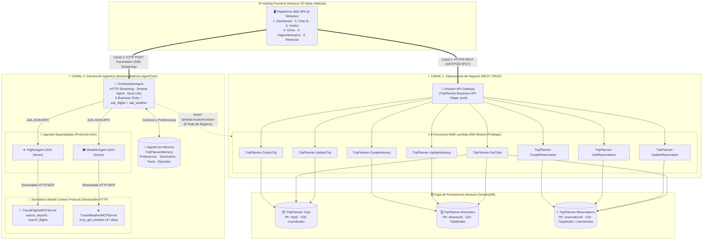
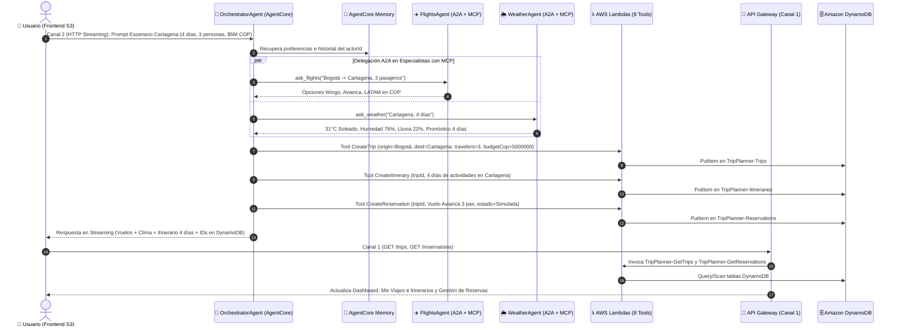

# Documentación Técnica · TripPlanner AI (Trabajo Final · Programación Agéntica)

**Your AI Travel Companion: Del Playground a una plataforma inteligente para planificar y gestionar viajes**

---

## 1. Arquitectura General de Dos Canales Independientes

La solución implementa una arquitectura distribuida sobre **AWS** que separa claramente el plano de **operaciones transaccionales de negocio (Canal 1)** del plano de **razonamiento e interacción agéntica multiagente con streaming (Canal 2)**, convergiendo en una única capa de persistencia en **Amazon DynamoDB**.



---

## 2. Flujo del Escenario Obligatorio de Demostración (Secuencia Completa)

> *"Quiero organizar unas vacaciones de cuatro días en Cartagena. Salgo desde Bogotá, viajo con dos personas más y tengo un presupuesto de 5 millones de pesos. Quiero conocer el clima, encontrar vuelos y organizar algunas actividades turísticas."*



---

## 3. Modelo de Datos en Amazon DynamoDB

Las tres tablas están declaradas en [template.yaml](../template.yaml) con facturación bajo demanda (`PAY_PER_REQUEST`) e Índices Secundarios Globales (`GSI`):

### 3.1 Tabla `TripPlanner-Trips`
* **Partition Key (`HASH`):** `tripId` (`String`, ej. `trip_a1b2c3d4`)
* **GSI (`UserIdIndex`):** `userId` (`String`)
* **Atributos principales:**
  * `title` (`String`): Nombre descriptivo del viaje (ej. *"Vacaciones de 4 Días en Cartagena de Indias"*).
  * `origin` (`String`): Ciudad de origen (ej. `"Bogotá"`).
  * `destination` (`String`): Ciudad de destino (ej. `"Cartagena"`).
  * `startDate` / `endDate` (`String`, ISO `YYYY-MM-DD`).
  * `travelers` (`Number`): Cantidad total de viajeros (ej. `3`).
  * `budgetCop` (`Number`): Presupuesto total en Pesos Colombianos (ej. `5000000`).
  * `status` (`String`): `Planificado` | `Confirmado` | `En Curso` | `Completado` | `Cancelado`.
  * `weatherSummary` (`String`): Resumen climático del destino.
  * `activeItineraryId` (`String`): Referencia al itinerario activo.
  * `createdAt` / `updatedAt` (`String`, ISO 8601 UTC).

### 3.2 Tabla `TripPlanner-Itineraries`
* **Partition Key (`HASH`):** `itineraryId` (`String`, ej. `itin_9f8e7d6c`)
* **GSI (`TripIdIndex`):** `tripId` (`String`)
* **Atributos principales:**
  * `tripId` (`String`): ID del viaje asociado.
  * `userId` (`String`): ID del viajero.
  * `destination` (`String`): Ciudad del itinerario.
  * `summary` (`String`): Descripción general de la agenda.
  * `days` (`List<Map>`): Lista de días con estructura:
    ```json
    [
      {
        "dayNumber": 1,
        "date": "2026-11-20",
        "title": "Día 1: Llegada y Ciudad Amurallada",
        "activities": [
          {
            "time": "15:30",
            "activity": "Tour guiado por Centro Histórico y Getsemaní",
            "costCop": 180000
          }
        ]
      }
    ]
    ```
  * `totalEstimatedCostCop` (`Number`): Suma automática de los costos de actividades en COP.

### 3.3 Tabla `TripPlanner-Reservations`
* **Partition Key (`HASH`):** `reservationId` (`String`, ej. `res_4b3c2d1a`)
* **GSIs:** `TripIdIndex` (`tripId`) y `UserIdIndex` (`userId`)
* **Atributos principales:**
  * `tripId` (`String`): ID del viaje al que pertenece la reserva.
  * `type` (`String`): `Vuelo` | `Hotel` | `Actividad` | `Transporte`.
  * `provider` (`String`): Proveedor o aerolínea (`Avianca`, `Wingo`, `LATAM`, `Hotel Caribe`, etc.).
  * `title` (`String`): Descripción del servicio reservado.
  * `referenceCode` (`String`): Código PNR/Referencia generado (ej. `TP-8F4A2C`).
  * `date` (`String`, `YYYY-MM-DD`): Fecha del servicio.
  * `priceCop` (`Number`): Valor total en COP.
  * `passengers` (`Number`): Número de personas cubiertas.
  * `status` (`String`): `Simulada` | `Pendiente` | `Confirmada` | `Cancelada`.
  * `details` (`Map`): Metadatos de horarios, número de vuelo y notas.

---

## 4. Catálogo de las 8 Tools, Funciones AWS Lambda y Endpoints API Gateway

| # | Tool en `OrchestratorAgent` | Función AWS Lambda | Endpoint API Gateway (Canal 1) | Tabla DynamoDB | Permiso IAM (Mínimo Privilegio) |
| :-: | :--- | :--- | :--- | :--- | :--- |
| 1 | `CreateTrip` | `TripPlanner-CreateTrip` | `POST /trips` | `TripPlanner-Trips` | `DynamoDBCrudPolicy` (`TripsTable`) |
| 2 | `GetTrips` | `TripPlanner-GetTrips` | `GET /trips`<br>`GET /trips/{tripId}` | `TripPlanner-Trips`<br>`Itineraries` + `Reservations` | `DynamoDBReadPolicy` (3 tablas) |
| 3 | `UpdateTrip` | `TripPlanner-UpdateTrip` | `PUT /trips/{tripId}` | `TripPlanner-Trips` | `DynamoDBCrudPolicy` (`TripsTable`) |
| 4 | `CreateItinerary` | `TripPlanner-CreateItinerary` | `POST /itineraries` | `TripPlanner-Itineraries`<br>`TripPlanner-Trips` | `DynamoDBCrudPolicy` (`Itineraries`, `Trips`) |
| 5 | `UpdateItinerary` | `TripPlanner-UpdateItinerary` | `PUT /itineraries/{itineraryId}` | `TripPlanner-Itineraries` | `DynamoDBCrudPolicy` (`ItinerariesTable`) |
| 6 | `CreateReservation` | `TripPlanner-CreateReservation` | `POST /reservations` | `TripPlanner-Reservations` | `DynamoDBCrudPolicy` (`ReservationsTable`) |
| 7 | `GetReservations` | `TripPlanner-GetReservations` | `GET /reservations` | `TripPlanner-Reservations` | `DynamoDBReadPolicy` (`ReservationsTable`) |
| 8 | `UpdateReservation` | `TripPlanner-UpdateReservation` | `PUT /reservations/{reservationId}` | `TripPlanner-Reservations` | `DynamoDBCrudPolicy` (`ReservationsTable`) |

---

## 5. Los 6 Módulos del Frontend (`frontend/index.html`)

1. **📊 Módulo 1 — Dashboard:** Resumen ejecutivo del usuario, KPIs dinámicos en COP, acceso rápido al escenario obligatorio de Cartagena y vista rápida de próximos viajes y reservas.
2. **💬 Módulo 2 — Asistente Conversacional:** Chat con HTTP Streaming directo hacia `OrchestratorAgent` (`/invocations`), chips de ejecución del escenario obligatorio y sincronización automática con DynamoDB.
3. **✈️ Módulo 3 — Consulta de Vuelos:** Tarjetas comparativas (Wingo, Avianca, LATAM) con horarios de salida/llegada, duración, precios por persona y grupales en COP, y botón de creación de reserva simulada en 1 clic.
4. **🌦️ Módulo 4 — Información Meteorológica:** Tarjeta principal de clima del destino (temperatura, probabilidad de lluvia, humedad, índice UV, viento y recomendaciones de equipaje) más desglose de pronóstico para los 4 días.
5. **🗺️ Módulo 5 — Mis Viajes e Itinerarios:** CRUD de viajes conectado al Canal 1 y agenda interactiva día por día con actividades horarias y costos estimados.
6. **🎫 Módulo 6 — Gestión de Reservas:** Listado filtrable por estado (*Simulada*, *Pendiente*, *Confirmada*), creación de reservas asociadas a un viaje y cambio de estado en tiempo real.

---

## 6. Guía de Despliegue y Ejecución

### 6.1 Ejecución Local Completa (1 comando)
```powershell
.\start_all_local.ps1
```
Esto inicia:
* `FlightsAgent` (A2A + MCP de Vuelos) en `http://localhost:9001`
* `WeatherAgent` (A2A + MCP de Clima) en `http://localhost:9002`
* `OrchestratorAgent` (HTTP Streaming + 8 Tools) en `http://localhost:8080`
* `Local Business API` (Emulador Canal 1 API Gateway + DynamoDB) en `http://localhost:8085`
* Abre la aplicación web en `frontend/index.html`.

### 6.2 Despliegue en AWS (SAM / CloudFormation + S3 + AgentCore)
```powershell
.\deploy_aws.ps1
```
O paso a paso:
```powershell
# 1. Validar y desplegar los 3 agentes y la memoria en Amazon Bedrock AgentCore
agentcore validate
agentcore deploy

# 2. Empaquetar y desplegar la plantilla AWS SAM (DynamoDB + 8 Lambdas + API Gateway + S3)
aws cloudformation package `
  --template-file template.yaml `
  --s3-bucket tripplanner-sam-artifacts-744617282997 `
  --output-template-file packaged.yaml

aws cloudformation deploy `
  --template-file packaged.yaml `
  --stack-name tripplanner-ai-stack `
  --capabilities CAPABILITY_IAM CAPABILITY_AUTO_EXPAND `
  --region us-east-1

# 3. Publicar el Frontend en el Bucket S3 de Hosting Estático
aws s3 sync frontend/ s3://tripplanner-ai-frontend-744617282997-us-east-1/ --acl public-read
```
